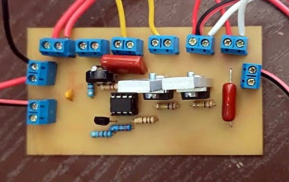
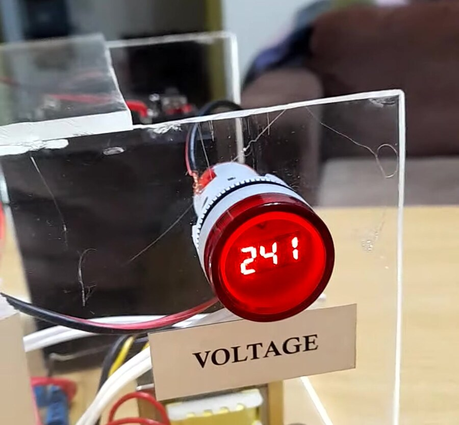
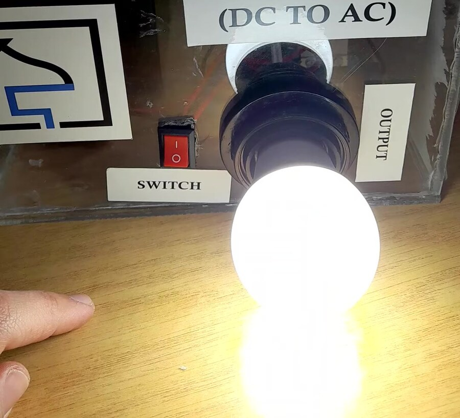
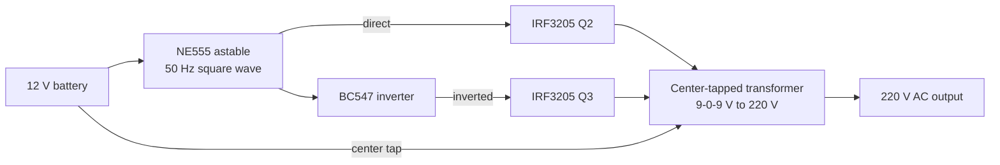
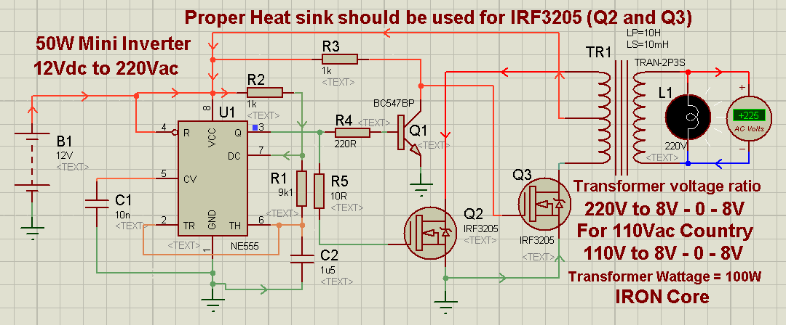
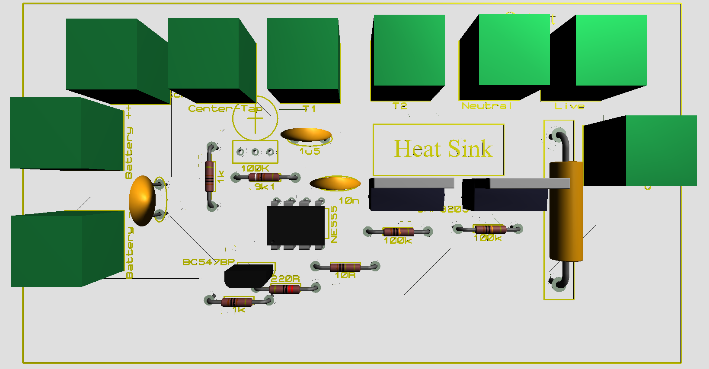
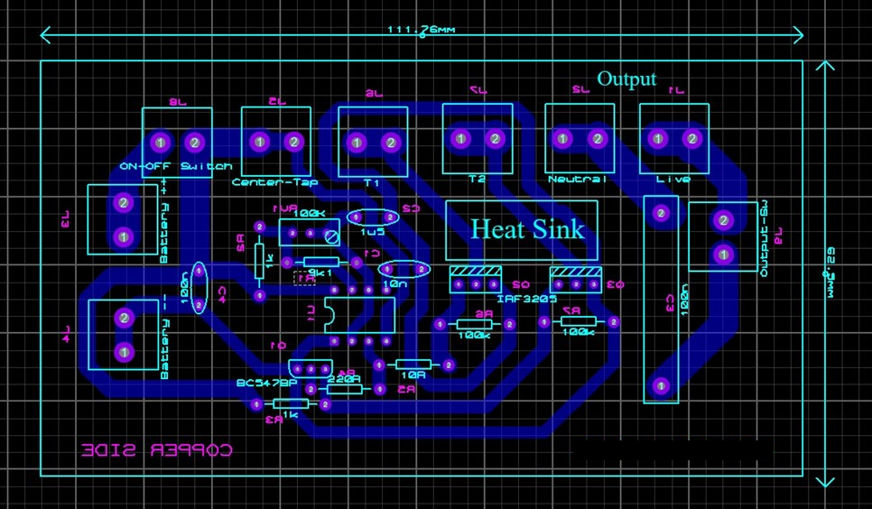
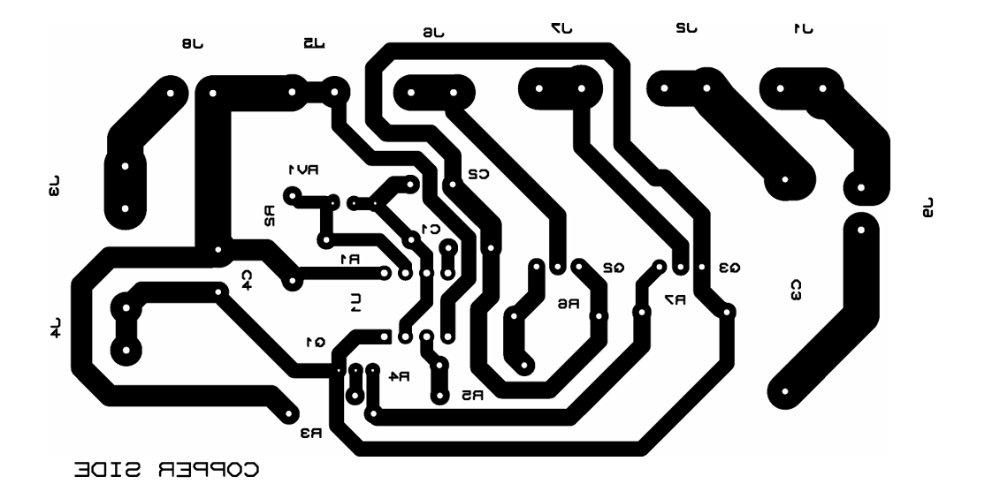
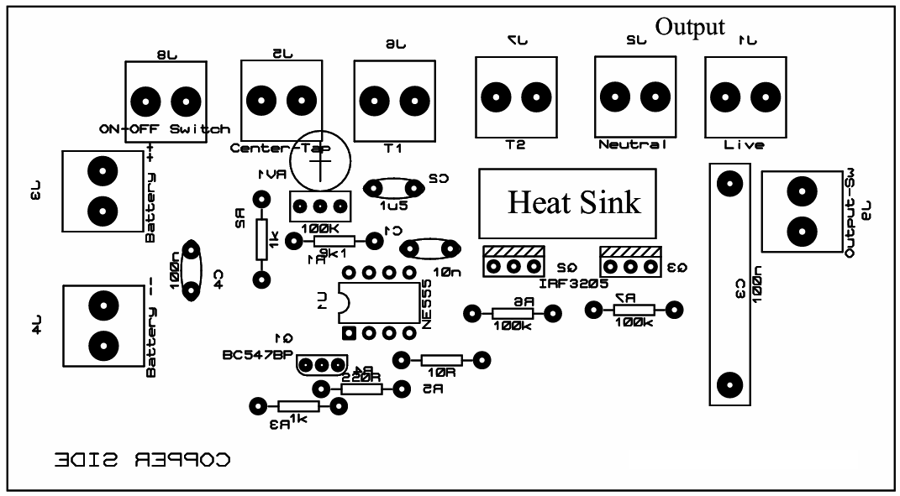

# 50 W DC–AC Inverter (12 V to 220 V)

A 12 V DC to 220 V AC square-wave inverter built around a 555 timer and two IRF3205 MOSFETs in push-pull, on a custom PCB I laid out, soldered and tested with real loads.

**Built:** May 2025 · Electronics lab project

## Results

| Metric | Result |
| --- | --- |
| Power rating | 50 W by design (transformer and MOSFET heat sinking); tested with small loads only |
| Output voltage | 241 V AC on the built-in panel voltmeter, with a bulb connected |
| Loads powered | Light bulb, phone charger |
| Frequency | 50 Hz by design, set with an on-board trimmer (not measured) |
| PCB | Single-sided, 112 mm wide, passed Proteus design-rule and connectivity checks |

| Output under load | Bulb powered from a 12 V battery |
| --- | --- |
|  |  |

## How it works

1. **Oscillator.** The NE555 runs in astable mode and produces a 50 Hz square wave.
2. **Two opposite gate signals.** One MOSFET gate takes the 555 output directly. A BC547 transistor inverts the signal for the other gate, so the two MOSFETs switch on alternately.
3. **Push-pull stage.** The battery feeds the transformer's center tap. Each MOSFET pulls one end of the primary to ground in turn, so current flows through the primary one way, then the other.
4. **Step-up.** The 9-0-9 V primary to 220 V secondary transformer turns this into a 220 V AC square wave.

*Circuit schematic from the original open-source design (see Credits). Component values are unchanged.*

## PCB design

| 3D view | Copper layout |
| --- | --- |
|  |  |

| Print mask: copper side, mirrored for transfer | Component side, used as a soldering guide |
| --- | --- |
|  |  |

I redrew the board in Proteus for building and testing:
- **Screw terminals** (9 in total) for battery, on/off switch, transformer center tap and ends, live, neutral and output, so the transformer and loads connect without soldering.
- **A 100 kΩ trimmer (RV1)** in the timing network, to tune the output to 50 Hz on the real board.
- **100 kΩ resistors at the MOSFET gates** and **two extra 100 nF capacitors**, added to the original circuit.
- **A shared heat sink** for both MOSFETs, with wide tracks on the high-current path.

## Hardware

| Part | Notes |
| --- | --- |
| NE555 | 50 Hz astable oscillator |
| BC547 | Signal inverter for the second MOSFET |
| 2× IRF3205 | Push-pull switches, on one heat sink |
| Center-tapped transformer | 9-0-9 V to 220 V step-up |
| 12 V lead-acid battery | Power source |
| Custom single-sided PCB | Etched and hand-soldered |
| Enclosure | Acrylic box with power switch, output socket and panel voltmeter |

## Repository layout

| File | Purpose |
| --- | --- |
| `README.md` | This page |
| `proteus/inverter_schematic.pdsprj` | Schematic and simulation (based on the original design) |
| `proteus/inverter_pcb.pdsprj` | Final PCB layout and 3D view |
| `media/` | Board photo, test photos, PCB views and schematic |
| `LICENSE-original-design` | Apache License 2.0 of the original circuit design |

## Open it

1. Install Proteus 8.10 or later.
2. Open `proteus/inverter_schematic.pdsprj` for the schematic and simulation.
3. Open `proteus/inverter_pcb.pdsprj` for the PCB layout and 3D view.

The schematic and the PCB were saved as two separate Proteus projects, so each opens in its own view.

No Proteus? The PCB views in `media/` show the full layout.

## Challenges and fixes

- **The MOSFETs overheated** without cooling, so both were mounted on a shared heat sink.
- **Getting a stable 50 Hz** from the 555 on the real board was tricky; the trimmer made it adjustable.

## Limitations and next steps

- **Square-wave output:** fine for bulbs and chargers, but not for motors or sensitive electronics. A pure-sine design (SPWM) is the next step.
- **The panel meter is not true-RMS,** so 241 V is an approximate reading for a square wave. Frequency, efficiency and maximum load were not measured.
- **Verifying the 50 W rating** needs a 50–60 W resistive load, true-RMS output voltage and current readings, battery current (about 5 A expected at full load) and a sustained run while watching MOSFET temperature.
- **No protection yet:** no low-battery cut-off, overload or short-circuit protection, and no battery charging (it is an inverter, not a UPS).

## Credits

The circuit design and its component values come from the open-source project **50W-Inverter-12V-to-220V-or-110V**, released under the Apache License 2.0 (copy in `LICENSE-original-design`). Changes in this project: a new PCB layout (screw terminals, trimmer, gate resistors, extra capacitors, heat-sink mounting), plus the physical build, enclosure and load testing.

## Author

**Michel Salame** — [LinkedIn](https://www.linkedin.com/in/michel-salame)
